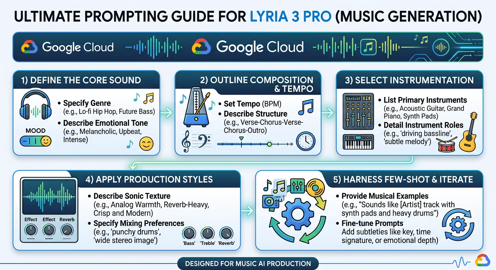
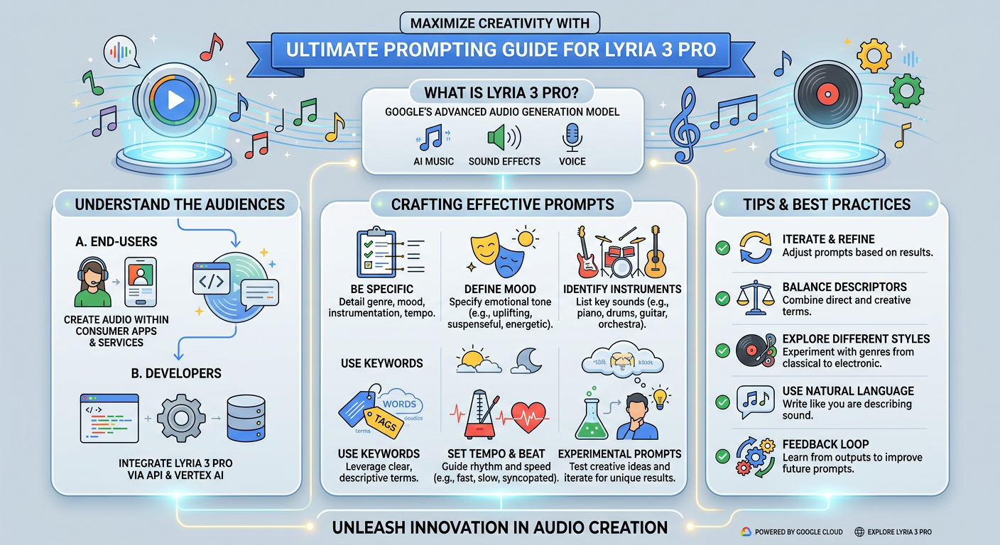
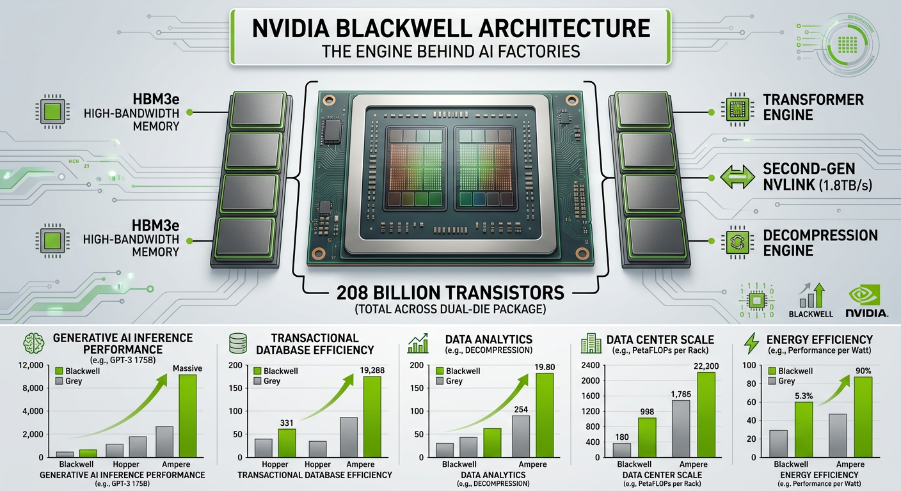
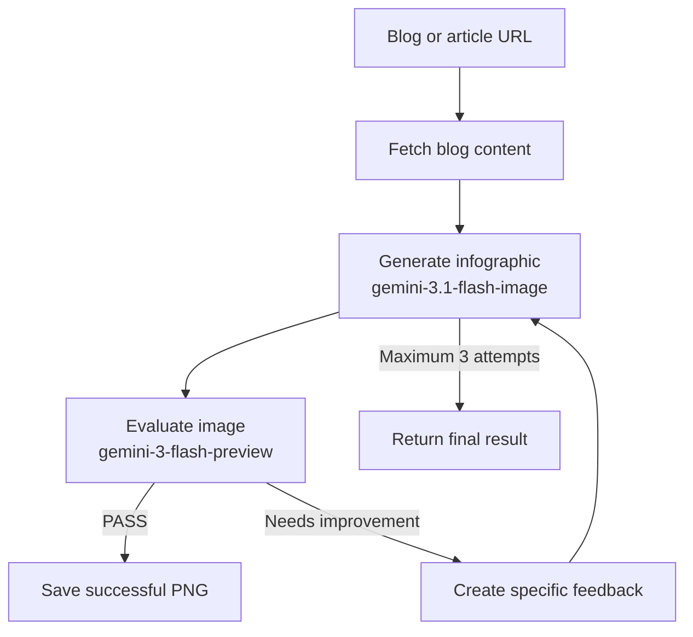

# Media Agent with AI

<div align="center">

### Turn a blog post into a polished, validated infographic

[](https://www.python.org/)
[](https://google.github.io/adk-docs/)
[](https://ai.google.dev/)
[](https://cloud.google.com/vertex-ai)
[](https://jupyter.org/)

**Fetch → Summarize → Generate → Evaluate → Improve**

</div>

---

## Overview

**Media Agent with AI** is a Jupyter-based autonomous media workflow built with the Google Agent Development Kit (ADK). It takes a public article URL, converts the article content into an infographic prompt, generates an image with Gemini, evaluates the result, and retries with specific feedback when quality checks fail.

The project demonstrates an agentic loop where an image model and a vision-enabled evaluator work together:

1. Fetch article content from a URL.
2. Generate a professional infographic.
3. Inspect it for factual accuracy, spelling, and aesthetic quality.
4. Feed failures back into the generator.
5. Repeat for a maximum of three attempts.

<div align="center">

## Example Outputs

<table>
  <tr>
    <td align="center" width="50%">
      
      <br />
      <sub><b>Google Cloud Blog</b> · Passed evaluation</sub>
    </td>
    <td align="center" width="50%">
      
      <br />
      <sub><b>Google Cloud Blog</b> · Passed evaluation</sub>
    </td>
  </tr>
  <tr>
    <td align="center" colspan="2">
      
      <br />
      <sub><b>NVIDIA Blackwell Architecture</b> · Last of three feedback-driven attempts</sub>
    </td>
  </tr>
</table>

</div>

> [!NOTE]
> Generated visuals are stored as 1408 × 768 PNG files. Evaluator feedback and intermediate results are recorded in `infographic_agent.log`.

---

## How It Works



The notebook defines an `InfographicAgent` with `infographic_workflow` as its only tool. The agent receives a target URL and coordinates the workflow through the following functions:

| Function | Responsibility |
|---|---|
| `fetch_blog_content()` | Downloads the URL and limits extracted content to 5,000 characters |
| `generate_infographic()` | Sends article content to Gemini's image model and saves a PNG |
| `evaluate_infographic()` | Uses Gemini vision to check facts, spelling, and visual alignment |
| `infographic_workflow()` | Runs the generate-evaluate-feedback loop for up to three attempts |
| `authenticate()` | Loads Google credentials and creates scoped Vertex AI credentials |

### Evaluation criteria

Each generated image is reviewed for:

- **Factual accuracy** — the infographic must agree with the source content
- **Spelling** — text must be free of obvious typos
- **Aesthetic alignment** — the layout and style must suit a professional article

If any criterion fails, the evaluator returns targeted feedback. The feedback is included in the next image-generation prompt, enabling corrective regeneration rather than an unbounded rerun.

---

## Project Structure

```text
Media Agent with AI/
├── media_agent.ipynb              # Main ADK agent notebook
├── helper.py                      # Authentication and notebook utilities
├── requirements.txt               # Python dependencies
├── infographic_agent.log          # Workflow history and evaluator feedback
├── infographic_*.png              # Generated infographic images
└── skills/
    ├── adk-agent-builder/
    │   └── SKILL.md               # Google ADK project reference
    └── nano-banana-image-gen/
        └── SKILL.md               # Nano Banana image-generation reference
```

---

## Prerequisites

- **Python 3.10+** — the notebook environment is configured for Python 3.11
- **Google Cloud project** with billing enabled
- **Vertex AI API** enabled
- Access to the Gemini image and evaluation models
- A Google Cloud service-account key JSON file
- Jupyter Notebook or JupyterLab

### Required Google Cloud permission

The service account should be authorized to call Vertex AI and any related Google Cloud services used by the project. The authentication helper requests the Cloud Platform scope.

---

## Installation

### 1. Clone or download the project

```bash
git clone <your-repository-url>
cd "Media Agent with AI"
```

### 2. Create a virtual environment

**Windows**

```powershell
py -3.11 -m venv .venv
.venv\Scripts\Activate.ps1
```

**macOS / Linux**

```bash
python3.11 -m venv .venv
source .venv/bin/activate
```

### 3. Install dependencies

```bash
python -m pip install --upgrade pip
python -m pip install -r requirements.txt
python -m pip install jupyter
```

### 4. Configure credentials

Create a `.env` file in the project directory:

```dotenv
GOOGLE_APPLICATION_CREDENTIALS=/absolute/path/to/credentials.json
GOOGLE_CLOUD_LOCATION=global
GOOGLE_VERTEX_BASE_URL=https://aiplatform.googleapis.com
GOOGLE_GENAI_USE_VERTEXAI=True
```

You may also place `credentials.json` in the project directory. The helper searches:

1. `GOOGLE_APPLICATION_CREDENTIALS`
2. `credentials.json` in the current directory
3. `credentials.json` in the parent directory

The helper derives the project ID from the service-account credentials and impersonates the service account for a two-hour scoped credential lifetime.

> [!WARNING]
> Never commit service-account keys or `.env` files. Add credentials and secret files to `.gitignore`.

---

## Run the Notebook

1. Start Jupyter:

   ```bash
   jupyter notebook media_agent.ipynb
   ```

2. Open the notebook and select a Python 3 kernel.
3. Run the setup cells to authenticate and initialize the ADK agent.
4. Update the `BLOG` URL if needed:

   ```python
   BLOG = "https://www.nvidia.com/en-us/data-center/technologies/blackwell-architecture/"
   ```

5. Run the workflow cell to create the infographic.
6. Open the project folder to view the timestamped PNG or inspect `infographic_agent.log`.

---

## Programmatic Usage

The notebook already exposes the main workflow function:

```python
result = infographic_workflow(
    "https://www.nvidia.com/en-us/data-center/technologies/blackwell-architecture/"
)

print(result)
```

A successful result is returned in this format:

```text
Success! Infographic saved at: infographic_YYYYMMDD_HHMMSS.png
```

If generation or evaluation fails, the function returns the logged error or the final feedback-driven attempt.

---

## Key Dependencies

| Package | Purpose |
|---|---|
| `google-genai` | Gemini and Vertex AI image generation |
| `google-adk` | Agent orchestration and runner |
| `google-cloud-aiplatform` | Google Cloud AI Platform integration |
| `python-dotenv` | Environment and credential configuration |
| `Pillow` | Opening and processing generated images |
| `requests` | Fetching article content |
| `matplotlib` / `numpy` | Visualization utilities from the helper module |
| `torch` / `transformers` | Additional model and evaluation ecosystem support |

---

## Generated Artifacts

Each successful or failed generation attempt creates a timestamped image:

```text
infographic_20261123_233622.png
```

The log contains:

- Starting URL
- Fetch status
- Generation attempt number
- Saved image path
- Evaluation result
- Regeneration feedback
- Final workflow outcome

Log entries use ISO-style timestamps, making them useful for debugging model behavior or comparing retries.

---

## Troubleshooting

### Credentials not found

Verify that `GOOGLE_APPLICATION_CREDENTIALS` points to an existing JSON key and that `credentials.json` is not misplaced.

```powershell
Test-Path $env:GOOGLE_APPLICATION_CREDENTIALS
```

### Model access denied

Confirm that:

- Vertex AI is enabled for the project
- The account or service account has sufficient permissions
- The configured model names are available in the selected location
- Your API quotas and billing are active

### URL fetch fails

The fetcher uses a 10-second timeout and only accepts successful HTTP responses. JavaScript-heavy or restricted pages may require manually supplying cleaner article text.

### Notebook API mismatch

Model names and SDK interfaces change over time. If an endpoint is retired, update the model identifiers in `media_agent.ipynb` and ensure `google-genai` and `google-adk` are current.

---

## Limitations

- Article extraction is heuristic and does not parse every webpage consistently.
- Evaluations are AI-generated and should not replace human factual review.
- Image generation can produce textual or numerical inaccuracies.
- The workflow is limited to three attempts per URL.
- Results depend on model availability, quotas, and regional access.
- The current notebook stores generated PNGs in the working directory.

---

## Security

Keep the following out of source control:

- `credentials.json`
- `.env`
- Service-account private keys
- Generated logs containing private prompts or source URLs

Use least-privilege service accounts and rotate credentials according to your organization's security policy.

---

## Contributing

1. Create a feature branch.
2. Keep notebook changes clear and reproducible.
3. Preserve the existing logging format.
4. Test authentication and at least one generate-evaluate cycle.
5. Document model or endpoint migrations in the notebook and README.

---

## License

No license file is currently included in this project. Add a `LICENSE` file before distributing or publishing derivative work.
